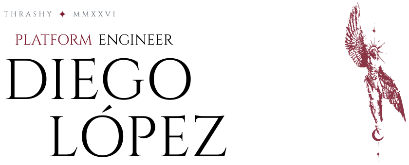
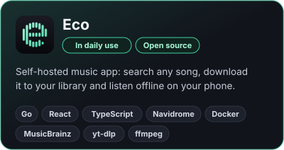
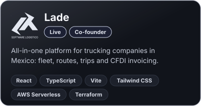
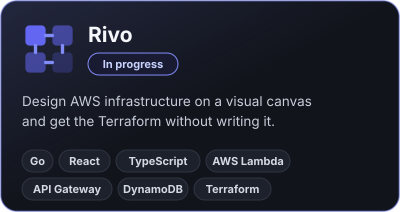
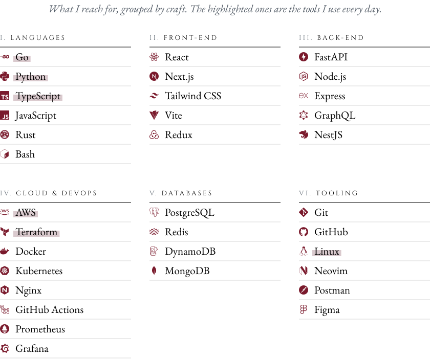

  <picture>
    <source media="(prefers-color-scheme: dark)" srcset="./titles/name-dark.svg"/>
    
  </picture>

 

<!--

  

 
-->

  
  
  
  
  

 

  <picture>
    <source media="(prefers-color-scheme: dark)" srcset="./titles/who-dark.svg"/>
    
  </picture>

 

**Platform & Site Reliability Engineer at Southwest Airlines | Co-founder of Dinoware and Lade**

I build the platforms other engineers deploy on: AWS, Terraform, Go and Python, with a focus on reliability and cloud cost (FinOps).

- Platforms that reach **1,000+ AWS accounts**
- **250K+ Lambda functions** analyzed in under four minutes
- A Bluetooth app that has unlocked **200K+ vehicles**

Outside work I build my own products, like the ones below.

 

  <picture>
    <source media="(prefers-color-scheme: dark)" srcset="./titles/projects-dark.svg"/>
    
  </picture>

 

  
  
   
  

 

  <picture>
    <source media="(prefers-color-scheme: dark)" srcset="./titles/tools-dark.svg"/>
    
  </picture>

 

  <picture>
    <source media="(prefers-color-scheme: dark)" srcset="./titles/arsenal-dark.svg"/>
    
  </picture>

